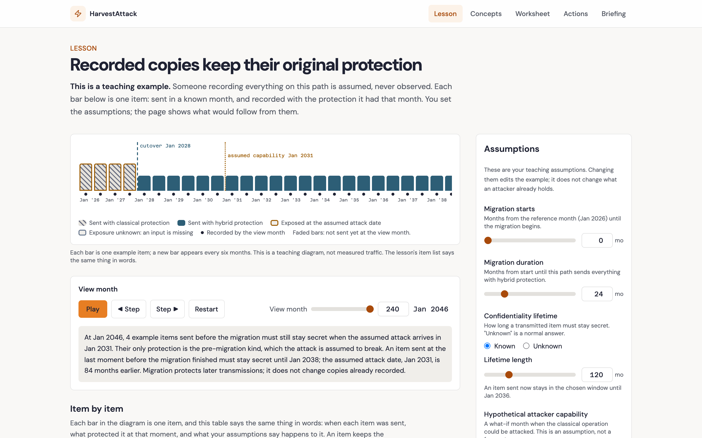

# HarvestAttack

Encrypted traffic can be recorded now and attacked later. Moving to post-quantum cryptography (PQC) protects traffic sent after the move. It cannot change a copy that someone already saved.

HarvestAttack is a free educational site that teaches this with one worked example, then helps you collect evidence about your own systems. It is live at <https://harvestattack.com> and made by [miaggy.com](https://miaggy.com).

No public evidence supports a specific date for when a machine might break today's public-key encryption, so the site does not publish one. You set the assumptions. The site shows what follows from them.

It is written for four kinds of visitor: people new to the topic, people who operate systems and services, people who own a security program, and people who administer a private CA or PKI.

[](https://harvestattack.com/understand)

## What is on the site

- [Lesson](https://harvestattack.com/understand): one illustrative path, recorded month by month. You choose when the migration starts and how long it takes, how long the data must stay secret, whether to assume someone is recording, and a hypothetical month when an attacker could break the pre-migration protection. The timeline, the ledger, and a plain-language result all come from the same model.
- [Concepts](https://harvestattack.com/learn): the four jobs in a protection stack, forward secrecy, hybrids and their conditions, signatures and verifiers, standards status, a private CA and PKI primer, and a glossary.
- [Worksheet](https://harvestattack.com/assess): three kinds of record (confidentiality flows, signing assets, and private CA or PKI reviews). Each piece of evidence is marked documented, configured, observed, or unknown. Unknown stays unknown. The worksheet suggests the next evidence to collect and never produces a score or a roadmap.
- [Actions](https://harvestattack.com/act): four short exercises on sample data, a copyable list of questions for a vendor, and an eight-step deployment framework.
- [Briefing](https://harvestattack.com/share): choose the records to include, redact owner names and evidence notes, and generate a document to copy, download as text, Markdown, or JSON, print, or open in your mail app. If anything changes after you generate it, export is disabled until you generate again. Nothing you enter is ever put in a share link.
- [Sources](https://harvestattack.com/sources) and [Updates](https://harvestattack.com/updates): every claim with its sources and review dates, and a log of corrections.

## What it does not do

- It does not predict when or whether a cryptographically relevant quantum computer will exist.
- It does not produce risk scores, readiness percentages, or compliance verdicts.
- It does not inspect your connection, scan your systems, or detect interception.
- It does not collect data. There are no analytics or trackers in the code, and nothing you type leaves your browser unless you export it. Saving to the device is off by default; if you turn it on, the copy in local storage is unencrypted.

The previous version of this site was a simulator with projected qubit counts, a decryption-progress meter, and forecast dates for when specific algorithms would break. It presented estimates as facts. It was withdrawn on 2026-10-15, and the Updates page records why. This repository is the rebuild.

## Development

Uses Node 24, the same version as CI.

```bash
npm install
npm run dev          # Dev server on http://localhost:8080
npm test             # vitest, single run
npm run test:watch   # vitest in watch mode
npm run lint         # ESLint
npm run typecheck    # tsc --noEmit, strict
npm run build        # Production build to dist/
npm run preview      # Serve the production build locally
```

## CI

Every push to `main` and every pull request runs lint, typecheck, tests, and a build. One further step greps `dist/assets/*.js` and fails if names from the retired forecast simulator (`qubitProgress`, `getDecryptionProgress`, `riskScore`, and others) reappear. The built `dist` directory is uploaded as an artifact.

## How it is built

Vite, React 18, TypeScript, Tailwind, and React Router 6. Pages are plain HTML with Tailwind classes. `@/` is an alias for `src/`. There is no backend: the site is a static build and every calculation runs in the browser.

- `src/domain/model.ts` is the lesson's model: pure and deterministic, with no UI, browser APIs, randomness, or clock. A cohort is one illustrative item transmitted in a given month, and its protection is fixed at transmission, so a migration never changes an older cohort. The month when an attacker could break the old protection is an input, never a forecast. `fixtures.ts` is the regression contract for the model.
- `src/content/` holds the claim registry (`claims.ts`) and the source registry (`sources.ts`).
- `src/state/` is one in-memory session shared by every route: the state and reducer in `session.tsx`, the provider in `SessionProvider.tsx`. It writes to `localStorage` only when the visitor opts in.
- `src/lib/` holds the worksheet types and suggestion rules (`contracts.ts`), the briefing snapshot and its formatters (`briefing.ts`), and clipboard and download helpers that report a failure to the visitor (`browser.ts`).
- `src/pages/` and `src/components/` hold the routes and the lesson parts.

Tests use vitest and Testing Library. Unit tests sit next to the code they cover; full journeys through the pages live in `src/test/`.

The design is a light editorial theme: warm off-white background, orange accent, white cards, thin borders, with DM Sans for text and Azeret Mono for code. Both fonts are self-hosted.

## Content rules

Every volatile statement on the site is a claim in `src/content/claims.ts` with a stable ID, a statement scoped to what its source supports, its sources, the date a maintainer last re-read them, and the date the next review is due.

- Render claims with `<ClaimRef id="..." />`. It links to the record on `/sources` and flags an overdue review.
- "Reviewed" means a maintainer opened the primary source on that date. An overdue review is flagged; it does not make the claim false.
- When a claim changes, raise its revision. When one is wrong, mark it withdrawn or superseded and record the correction on `/updates`. Do not rewrite it quietly.
- Overdue status is measured against `CONTENT_DATE` in `src/content/claims.ts`. Move it forward at each content release. The registry tests fail if an active claim is overdue as of that date, or if anything was checked after it, so a release cannot ship with a lapsed review.
- `src/content/claims.test.ts` checks the registry and pins the scoping rules, such as reading missing telemetry as unknown.

The copy is plain prose a curious 15-year-old can follow, with no em-dashes and no hype vocabulary. Show what is at stake with a concrete mechanism instead of calling it important.

## Deployment

The site is a static build hosted on Cloudflare Pages (project `harvestattack`), which serves harvestattack.com and harvestattack.pages.dev. Pages serves `index.html` for the client-side routes, so no redirects file is needed.

Deployment is manual, so pushing to `main` runs the gates without publishing. From `main`:

```bash
npm run build
npm run preview                                   # optional: check the build locally
npx wrangler pages deploy dist --project-name harvestattack
```

Wrangler asks for a Cloudflare login the first time it runs.

## Reporting an error

Include the claim ID from the `/sources` page (for example `claim-fips-203-final`) so the correction can be traced to its record. Do not send private keys, certificates, or internal hostnames.

## License

MIT. See [LICENSE](LICENSE). This covers the site's code and its written content.
